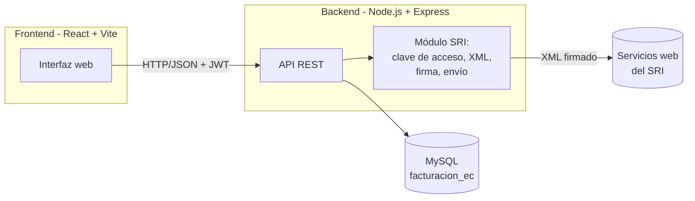

# Sistema de Facturación, Cotización y Gestión Multi-Negocio (Ecuador)

Sistema pensado para arrancar **local** (tu computador o un servidor de tu
oficina) y crecer sin reescribirse: mismo backend, misma base de datos,
mismo frontend, solo cambian variables de entorno cuando lo subas a un
servidor en la nube. Estructurado para varios negocios (multi-tenant),
con roles de trabajador/administrador/super-administrador, y con el
camino ya trazado para conectar la facturación electrónica real con el
Servicio de Rentas Internas (SRI) de Ecuador.

## 1. Arquitectura



- **Base de datos:** MySQL, con un script `database/schema.sql` que puedes
  abrir y ejecutar directamente en **MySQL Workbench**.
- **Backend:** Node.js + Express + Sequelize (ORM), autenticación con JWT,
  y un módulo separado (`services/sri`) para todo lo relacionado al SRI.
- **Frontend:** React + Vite, con rutas protegidas por rol.
- **Multi-negocio:** todas las tablas cuelgan de `empresa_id`; un mismo
  despliegue puede operar muchos negocios sin mezclar su información.

## 2. Estructura de carpetas

```
sistema-facturacion-ec/
├── database/
│   └── schema.sql            ← Ejecuta esto en MySQL Workbench
├── backend/
│   ├── src/
│   │   ├── config/db.js      ← Conexión a MySQL
│   │   ├── models/           ← Un archivo por tabla (Sequelize)
│   │   ├── middleware/       ← auth (JWT), roles, multi-negocio
│   │   ├── controllers/      ← Lógica de cada módulo
│   │   ├── routes/           ← Endpoints REST
│   │   ├── services/sri/     ← Clave de acceso, XML, firma, envío SRI
│   │   ├── utils/            ← Cálculos de IVA, cifrado, seed inicial
│   │   ├── app.js
│   │   └── server.js
│   └── .env.example
└── frontend/
    ├── src/
    │   ├── api/axiosClient.js
    │   ├── context/AuthContext.jsx
    │   ├── layouts/MainLayout.jsx
    │   └── pages/            ← Login, Dashboard, Cotizaciones, Facturas...
    └── .env.example
```

## 3. Puesta en marcha local

### 3.1 Base de datos

1. Abre **MySQL Workbench**, conéctate a tu servidor MySQL local.
2. `File → Open SQL Script...` y selecciona `database/schema.sql`.
3. Ejecuta el script completo (ícono del rayo). Esto crea la base
   `facturacion_ec` con todas las tablas, catálogos del SRI (formas de
   pago, tipos de identificación) e índices.
4. Opcional: `Database → Reverse Engineer...` para ver el diagrama EER
   completo generado automáticamente por Workbench.

### 3.2 Backend

```bash
cd backend
cp .env.example .env
# Edita .env con tu usuario/clave de MySQL local
npm install
npm run seed        # Crea el usuario super_admin inicial
npm run dev          # Levanta el API en http://localhost:4000
```

Por defecto, `npm run seed` crea:
- Usuario: `admin@sistema.local`
- Contraseña: `CambiarInmediatamente123!`

Puedes personalizarlos así:
```bash
SEED_ADMIN_EMAIL=tucorreo@negocio.com SEED_ADMIN_PASSWORD=unaClaveSegura123 npm run seed
```

### 3.3 Frontend

```bash
cd frontend
cp .env.example .env
npm install
npm run dev          # Levanta la web en http://localhost:5173
```

### 3.4 Primer uso

1. Entra con el super_admin.
2. Ve a **Negocios** → crea tu primer negocio (RUC, razón social, dirección).
3. Pulsa **"Trabajar aquí"** para activarlo.
4. Ve a **Establecimientos** → crea al menos un establecimiento y un punto
   de emisión (ya viene uno creado automáticamente al crear el negocio).
5. Ve a **Usuarios** → crea administradores/trabajadores para ese negocio.
6. Ve a **Clientes** y **Productos** → carga tu catálogo.
7. Empieza a generar **Cotizaciones** y convertirlas en **Facturas**.

## 4. Roles del sistema

| Rol | Alcance |
|---|---|
| `super_admin` | Ve y administra **todos** los negocios del sistema. Crea negocios nuevos. |
| `admin` | Administra **su** negocio: usuarios, establecimientos, catálogos, cotizaciones y facturas. |
| `trabajador` | Opera dentro de su negocio: crea cotizaciones y facturas, gestiona clientes/productos (sin poder de administración). |

La separación entre negocios se hace en cada consulta con `empresa_id`
(ver `backend/src/middleware/tenant.js`), así que aunque la base de datos
sea una sola, ningún negocio puede ver los datos de otro.

## 5. Camino hacia la facturación electrónica real con el SRI

El sistema ya genera **la estructura completa** que exige el SRI para una
factura electrónica (comprobante tipo `01`):

- ✅ Clave de acceso de 49 dígitos con dígito verificador Módulo 11
  (`backend/src/services/sri/claveAcceso.js`).
- ✅ XML de factura con `infoTributaria`, `infoFactura`, `detalles` e
  `infoAdicional` (`backend/src/services/sri/xmlBuilder.js`).
- ✅ Tabla `comprobantes_sri` que guarda el ciclo de vida completo: XML
  generado, XML firmado, estado, número y fecha de autorización.
- 🟡 Firma electrónica XAdES-BES: **queda en modo simulado**
  (`services/sri/firmaElectronica.js`), a la espera de tu certificado.
- 🟡 Envío a los Web Services SOAP de Recepción/Autorización del SRI:
  **queda en modo simulado** (`services/sri/soapClient.js`).

### Pasos para activar la integración real

1. **Obtén tu firma electrónica** (Security Data, Uanataca, Banco Central
   del Ecuador, ANF AC Ecuador, u otro proveedor autorizado), en formato
   `.p12`/`.pfx`.
2. **Regístrate en el SRI en Línea**: cuenta bancaria y autorización para
   emitir comprobantes electrónicos (portal del SRI, sección
   Facturación Electrónica → Pruebas).
3. Guarda el `.p12` **fuera del repositorio** (nunca lo subas a git) y
   registra su ubicación y vigencia en la tabla `certificados_firma`
   (la contraseña se guarda cifrada con `utils/crypto.js`, nunca en texto
   plano).
4. Implementa la firma real en `firmaElectronica.js` usando una librería
   de firma XAdES-BES para Node, cargando el `.p12` y devolviendo el XML
   firmado.
5. Implementa el cliente SOAP real en `soapClient.js` apuntando a los
   endpoints de **Recepción** y **Autorización** del ambiente de
   **Pruebas** (variables `SRI_WS_*_PRUEBAS` en `.env`).
6. Cambia `empresas.ambiente_sri` a `PRODUCCION` y las URLs a
   `SRI_WS_*_PRODUCCION` solo cuando hayas validado varias facturas de
   prueba y estés autorizado a facturar en producción.

> ⚠️ **Importante:** valida siempre la estructura del XML, los catálogos
> (formas de pago, tipos de comprobante, códigos de IVA) y las URLs de
> los Web Services contra la **Ficha Técnica de Comprobantes
> Electrónicos** vigente, publicada en el portal del SRI — esta
> normativa se actualiza periódicamente y este proyecto debe ajustarse
> a la versión vigente antes de emitir en producción.

## 6. De "local" a "en la nube": qué cambia y qué no

El diseño ya sigue el principio de **"config por entorno"**, así que para
pasar de tu computador a un servidor (o a un proveedor cloud) normalmente
solo tendrás que:

1. Mover la base de datos MySQL a un servidor administrado (o mantener tu
   propio servidor MySQL) y actualizar `DB_HOST`, `DB_USER`, `DB_PASSWORD`
   en el `.env` del backend.
2. Desplegar la carpeta `backend/` en cualquier servicio que corra
   Node.js, y `frontend/` como sitio estático (tras `npm run build`) o
   detrás de un mismo dominio.
3. Servir todo bajo HTTPS y actualizar `VITE_API_URL` en el frontend para
   que apunte al dominio del backend en producción.
4. Cambiar `JWT_SECRET` y `APP_MASTER_KEY` por valores fuertes y únicos
   del entorno de producción (nunca reutilices los de desarrollo).

Nada del modelo de datos ni de la lógica de negocio depende de que corra
"local"; el multi-negocio, los roles y el módulo SRI funcionan igual.

## 7. Próximos pasos sugeridos

- Generación de PDF (RIDE) a partir del XML autorizado.
- Notas de crédito/débito y guías de remisión (ya contempladas en el
  esquema de base de datos, con sus propios secuenciales).
- Reportes de ventas por período/IVA para la declaración mensual.
- Envío automático de la factura y el RIDE por correo al cliente.
- Migración de `sequelize.sync()` a migraciones versionadas antes de
  operar en producción con datos reales.
